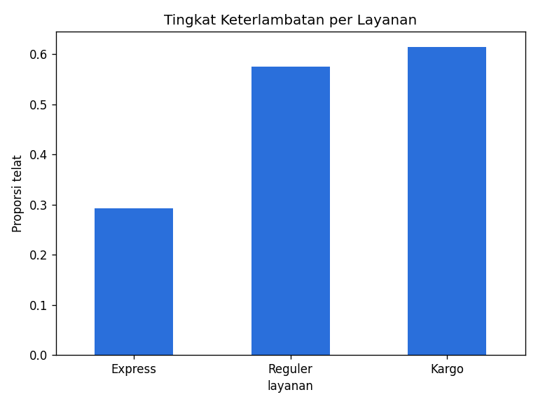
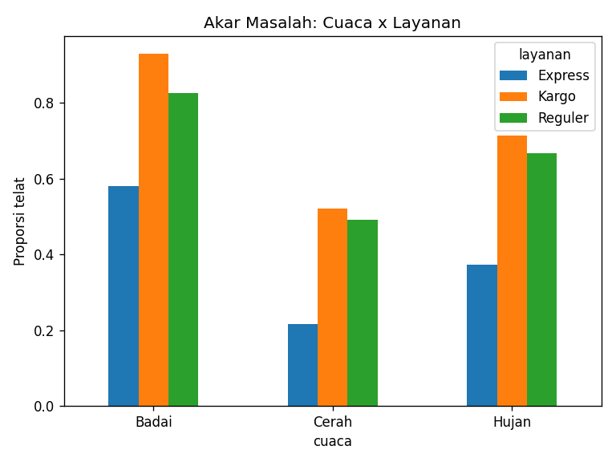
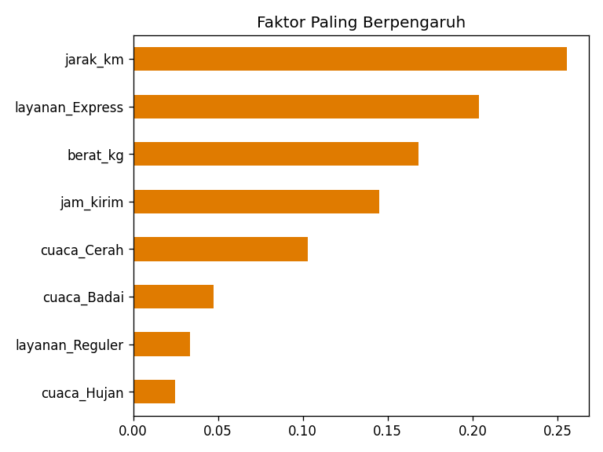

<div align="center">

# 📦 Analitik Keterlambatan Pengiriman Paket

### Studi Kasus *Patterns of Data with Analysis and AI*: dari data mentah menjadi keputusan


</div>

---

## 📑 Daftar Isi
1. [Latar Belakang](#-latar-belakang)
2. [Rumusan Masalah & Tujuan](#-rumusan-masalah--tujuan)
3. [Batasan Masalah](#-batasan-masalah)
4. [Kaitan dengan Materi (Piramida Analitik)](#-kaitan-dengan-materi-piramida-analitik)
5. [Dataset](#-dataset)
6. [Alur Kerja](#-alur-kerja)
7. [Struktur Proyek](#-struktur-proyek)
8. [Cara Menjalankan](#-cara-menjalankan)
9. [Hasil](#-hasil)
10. [Peran Manusia & Etika](#-peran-manusia--etika)
11. [Keterbatasan & Pengembangan](#-keterbatasan--pengembangan)

---

## 🎯 Latar Belakang
Sebuah perusahaan ekspedisi di Sumatera menerima ribuan paket per hari. Hampir **separuh** paket tiba terlambat, memicu komplain dan biaya kompensasi. Manajemen tidak hanya ingin tahu *berapa* yang telat, tetapi juga *mengapa*, *paket mana yang berisiko*, dan *apa tindakannya*.

Proyek ini menjawabnya dengan menerapkan **empat tingkat analitik** dari materi Sesi 1 (Bapak Andrea Arisal, BRIN) pada satu alur kerja yang utuh.

## ❓ Rumusan Masalah & Tujuan
| # | Pertanyaan | Tujuan |
|---|---|---|
| 1 | Seberapa sering paket terlambat? | Merangkum kondisi saat ini |
| 2 | Faktor apa penyebab utamanya? | Menemukan akar masalah |
| 3 | Paket mana yang berpotensi telat? | Membangun model prediksi |
| 4 | Tindakan apa yang sebaiknya diambil? | Menghasilkan rekomendasi operasional |

## 🚧 Batasan Masalah
- Data bersifat **sintetis** (dibuat dengan `numpy`, seed 42), bukan data perusahaan nyata.
- Jumlah data **3.000 paket** dengan 5 fitur utama: jarak, berat, layanan, cuaca, jam kirim.
- Target prediksi berupa **klasifikasi biner** (telat / tepat waktu), bukan lama keterlambatan.
- Model memakai **satu algoritma** (Random Forest) tanpa tuning lanjutan, agar sederhana.
- Rekomendasi prescriptive berbasis **aturan (rule-based)**, bukan optimasi matematis.
- Tidak mencakup biaya, kapasitas armada, atau data real-time.

## 🔺 Kaitan dengan Materi (Piramida Analitik)

```
 Data mentah ─► Informasi ─► Insight ─► Keputusan
 (CSV kotor)    (data bersih  (faktor     (daftar tindakan
                 + ringkasan)   penyebab)   per paket)
```

| Tingkat | Pertanyaan | Implementasi di proyek ini |
|---|---|---|
| **Descriptive** | Apa yang terjadi? | Persentase telat total dan per layanan |
| **Diagnostic** | Mengapa terjadi? | Tabel silang cuaca × layanan, efek jam kirim |
| **Predictive** | Apa yang akan terjadi? | Random Forest memprediksi probabilitas telat |
| **Prescriptive** | Apa yang harus dilakukan? | Rekomendasi tindakan untuk paket berisiko ≥ 60% |

## 🗃️ Dataset
Dihasilkan oleh `src/generate_data.py`. Kolom utama:

| Kolom | Deskripsi |
|---|---|
| `resi_id` | ID unik paket |
| `nama_penerima`, `no_hp` | Data pribadi (PII), **dihapus/dianonimkan** saat persiapan data |
| `jarak_km`, `berat_kg` | Jarak dan berat paket |
| `layanan` | Reguler / Express / Kargo |
| `cuaca` | Cerah / Hujan / Badai |
| `jam_kirim` | Jam pengiriman (7–21) |
| `telat` | Target: 1 = telat, 0 = tepat waktu |

Data sengaja dikotori: **60 duplikat**, **40 jarak negatif**, **90 berat kosong**, dan **15 berat mustahil (999 kg)**, untuk menggambarkan bahwa persiapan data memakan 60–70% pekerjaan.

## 🔄 Alur Kerja
```
generate_data.py ─► pengiriman_raw.csv
                        │
                        ▼
              [0] Persiapan Data  (dedupe, perbaiki anomali, imputasi, anonimisasi)
                        │
        ┌───────────────┼───────────────┬────────────────┐
        ▼               ▼               ▼                ▼
  [1] Descriptive  [2] Diagnostic  [3] Predictive   [4] Prescriptive
                                  (Random Forest)   (rekomendasi tindakan)
```

## 📁 Struktur Proyek
```
analitik-ekspedisi/
├── data/
│   ├── pengiriman_raw.csv        # data mentah (kotor)
│   └── pengiriman_bersih.csv     # data setelah persiapan
├── src/
│   ├── generate_data.py          # pembuat data sintetis
│   └── analisis.py               # pipeline 4 tingkat analitik
├── output/
│   ├── 1_descriptive_layanan.png
│   ├── 2_diagnostic_cuaca_layanan.png
│   ├── 3_predictive_importance.png
│   ├── rekomendasi_tindakan.csv
│   └── hasil_konsol.txt
├── requirements.txt
├── LICENSE
└── README.md
```

## ▶️ Cara Menjalankan
```bash
# 1. Clone & masuk folder
git clone https://github.com/<username>/analitik-ekspedisi.git
cd analitik-ekspedisi

# 2. (opsional) buat virtual environment
python -m venv .venv && source .venv/bin/activate   # Windows: .venv\Scripts\activate

# 3. Pasang dependensi
pip install -r requirements.txt

# 4. Buat data lalu jalankan analisis
python src/generate_data.py
python src/analisis.py
```
Hasil grafik dan CSV akan muncul di folder `output/`. Karena memakai seed tetap, hasilnya **dapat direproduksi**.

## 📊 Hasil

### Persiapan data
| Langkah | Jumlah |
|---|---|
| Baris awal | 3.060 |
| Duplikat dibuang | 60 |
| Jarak negatif diperbaiki | 40 |
| Berat kosong/anomali diimputasi (median) | 104 |
| Baris bersih | 3.000 |

### 1️⃣ Descriptive
Tingkat keterlambatan keseluruhan **50,7%**.

| Layanan | % Telat |
|---|---|
| Express | 29,3% |
| Reguler | 57,6% |
| Kargo | 61,5% |



### 2️⃣ Diagnostic
- Cuaca **Badai** adalah pemicu terbesar: Kargo telat **93%**, Reguler **82,6%**.
- Pengiriman **setelah pukul 18.00** telat **65,5%**, dibanding **45,2%** sebelum 18.00.
- Express paling tahan, tetapi tetap naik drastis saat badai (21,6% → 58,1%).



### 3️⃣ Predictive
Random Forest (200 pohon, kedalaman 6), data uji 25%:

| Metrik | Nilai |
|---|---|
| ROC-AUC | **0,750** |
| Akurasi | 68,5% |
| F1 (telat) | 0,691 |



### 4️⃣ Prescriptive
Dari 750 paket data uji, **277 paket** berisiko tinggi (probabilitas ≥ 60%):

| Rekomendasi | Jumlah |
|---|---|
| Tawarkan upgrade ke Express | 79 |
| Prioritaskan di sortir (pantau manual) | 77 |
| Jadwalkan ulang ke batch pagi | 69 |
| Tunda/alihkan rute & kabari penerima | 52 |

Daftar lengkap ada di `output/rekomendasi_tindakan.csv`.

## 🧠 Peran Manusia & Etika
Sesuai materi, AI tidak menggantikan analis:
- **Konteks bisnis**: aturan "Badai = tunda" dan ambang 700 km ditentukan manusia, bukan model.
- **Anomali data**: berat 999 kg hanya bisa dikenali sebagai salah input oleh manusia yang paham domain.
- **Verifikasi**: akurasi 68,5% berarti sekitar 1 dari 3 prediksi keliru, sehingga hasil perlu dicek sebelum dieksekusi.
- **Privasi**: nama dan nomor HP dihapus, diganti hash SHA-256 terpotong.
- **Reproduksibilitas**: seed tetap dan seluruh langkah tercatat dalam kode.

## ⚠️ Keterbatasan & Pengembangan
- Data sintetis, sehingga pola di dunia nyata bisa berbeda.
- Ide lanjutan: uji model lain (Gradient Boosting), tambah fitur (kemacetan, hari libur), threshold berbasis biaya, dashboard Streamlit.

## 📜 Lisensi
MIT, bebas dipakai untuk belajar dan dikembangkan.
