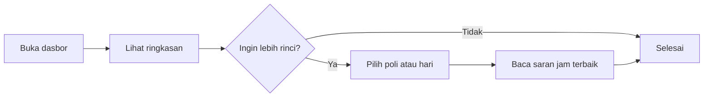

<div align="center">

# 🏥 Dasbor Antrean Puskesmas

### Studi Kasus Interaksi Manusia Komputer (IMK) · Sesi 5

*Kapan waktu terbaik berobat? Dijawab dengan satu layar yang mudah dipahami, inklusif, dan jujur.*


</div>

---

## 📌 Daftar Isi

1. [Latar Belakang](#-latar-belakang)
2. [Rumusan Masalah dan Tujuan](#-rumusan-masalah-dan-tujuan)
3. [Batasan Masalah](#-batasan-masalah)
4. [Analisis Pengguna dan Persona](#-analisis-pengguna-dan-persona)
5. [Keterkaitan dengan Materi Sesi 5](#-keterkaitan-dengan-materi-sesi-5)
6. [Fitur](#-fitur)
7. [Alur Interaksi](#-alur-interaksi)
8. [Cara Menjalankan](#-cara-menjalankan)
9. [Struktur Proyek](#-struktur-proyek)
10. [Evaluasi Usability](#-evaluasi-usability)
11. [Pengembangan Lanjutan](#-pengembangan-lanjutan)
12. [Cara Mengunggah ke GitHub](#-cara-mengunggah-ke-github)

---

## 🧭 Latar Belakang

Antrean puskesmas sering terasa tidak pasti. Pasien datang pagi-pagi, lalu menunggu berjam-jam tanpa tahu apakah jam lain lebih sepi. Informasi sebenarnya ada, tetapi tidak disajikan dengan cara yang mudah dipakai, terutama oleh pasien lansia, pengguna ponsel murah, atau orang yang tidak terbiasa membaca grafik.

Studi kasus ini merancang **dasbor antrean sederhana** yang menjawab satu pertanyaan utama: *"Poli mana, hari apa, dan jam berapa yang waktu tunggunya paling singkat?"* Proyek ini sengaja kecil agar fokus pada penerapan prinsip IMK, bukan pada kerumitan teknis.

> ⚠️ Seluruh data dalam proyek ini **fiktif** dan dibuat untuk pembelajaran.

## 🎯 Rumusan Masalah dan Tujuan

**Rumusan masalah**

1. Bagaimana menyajikan data antrean agar pasien memahaminya tanpa beban kognitif berlebih?
2. Bagaimana memastikan dasbor dapat dipakai oleh pengguna dengan keterbatasan penglihatan atau motorik?
3. Bagaimana mengukur apakah dasbor tersebut benar-benar mudah dipakai?

**Tujuan**

- Menerapkan prinsip *User-Centered Design* pada kasus nyata.
- Menerapkan mantra Shneiderman pada visualisasi data.
- Membangun dasbor yang memenuhi prinsip aksesibilitas WCAG dan bebas *dark patterns*.
- Menyediakan instrumen evaluasi usability (SUS) di dalam produk itu sendiri.

## 🚧 Batasan Masalah

| Aspek | Batasan |
|---|---|
| Data | Data simulasi 4 poli (Umum, Gigi, KIA, Lansia), 6 hari kerja, jam 08.00 sampai 13.00 |
| Teknologi | HTML, CSS, JavaScript murni tanpa framework, tanpa server, tanpa basis data |
| Fungsi | Hanya **membaca** dan menyaring data. Tidak ada pendaftaran antrean atau data pribadi pasien |
| Platform | Peramban modern (Chrome, Firefox, Edge, Safari), tampilan responsif untuk ponsel |
| Evaluasi | Skor SUS dihitung di peramban dan tidak disimpan atau dikirim |
| Aksesibilitas | Mengacu pada WCAG 2.1 AA, namun belum diuji dengan audit formal atau pembaca layar nyata |

## 👤 Analisis Pengguna dan Persona

**Persona utama**

> ### Bu Rahmah, 58 tahun
> Pedagang sayur di Pasar Panorama, Bengkulu. Menderita hipertensi dan kontrol rutin tiap bulan.
>
> - **Perangkat:** ponsel Android layar kecil, kadang lupa kacamata
> - **Kebutuhan:** tahu jam yang sepi agar tidak menutup lapak terlalu lama
> - **Hambatan:** tulisan kecil, istilah teknis, grafik yang rumit
> - **Kutipan:** *"Saya cuma mau tahu, datang jam berapa supaya cepat."*

**Persona sekunder:** Dimas (24), mahasiswa yang mengantar neneknya berobat dan terbiasa dengan aplikasi, tetapi ingin hasil yang cepat dibaca.

**Kebutuhan pengguna yang diturunkan**

| Kebutuhan | Solusi pada desain |
|---|---|
| Cepat paham gambaran umum | Tiga angka ringkasan di bagian atas |
| Tidak bingung dengan banyak grafik | Hanya dua grafik, masing-masing satu pesan |
| Mudah dibaca dan ditekan | Huruf besar, target sentuh minimal 44 px |
| Diberi saran yang jelas | Kotak saran "datang sekitar pukul ..." |

## 🔗 Keterkaitan dengan Materi Sesi 5

| Konsep dari materi | Penerapan di proyek |
|---|---|
| **User-Centered Design** | Dirancang dari persona dan kebutuhan Bu Rahmah |
| **Analisis kebutuhan dan persona** | Bagian analisis pengguna di atas |
| **Beban kognitif (*cognitive load*)** | Satu pesan per grafik, hanya 3 angka ringkasan, label langsung pada data, rincian muncul hanya saat diminta |
| **Model pemrosesan informasi** | Warna dan pola dipakai bersama teks agar informasi tidak bergantung pada satu indera |
| **Aksesibilitas (WCAG)** | Tautan lompat, kontras tinggi, fokus keyboard terlihat, `aria-label`, tabel pengganti grafik, mode gelap, hormati `prefers-reduced-motion` |
| **Etika dan *dark patterns*** | Tanpa pop-up, tanpa hitung mundur palsu, tanpa pelacakan, tanpa tombol yang menyesatkan |
| **Visualisasi data, anti *chartjunk*** | Tanpa efek 3D, tanpa dekorasi, garis kisi tipis, angka langsung pada batang |
| **Mantra Shneiderman** | *Overview first* → *zoom and filter* → *details on demand* (lihat di bawah) |
| **Teknik evaluasi usability** | Kuesioner SUS bawaan yang menghitung skor otomatis |

### Mantra Shneiderman pada dasbor

| Tahap | Wujud di dasbor |
|---|---|
| Overview first | Tiga kartu ringkasan dan grafik batang waktu tunggu semua poli |
| Zoom and filter | Pilihan poli dan hari, serta klik batang untuk menyaring poli |
| Details on demand | Panel rincian per jam dan saran jam terbaik, hanya muncul setelah poli dipilih |

## ✨ Fitur

- 📊 **Ringkasan instan:** total pasien, rata-rata waktu tunggu, poli paling lama menunggu
- 🔎 **Penyaringan:** per poli dan per hari, dengan tombol *Tampilkan semua*
- 📉 **Grafik batang:** poli yang melewati 25 menit ditandai **warna, pola garis, dan teks "(lama)"**
- 📈 **Grafik garis:** waktu tunggu menurut jam, lengkap dengan angka pada tiap titik
- 🧾 **Rincian:** tabel per jam yang dapat dibaca pembaca layar
- ♿ **Aksesibilitas:** navigasi keyboard penuh, mode gelap otomatis, target sentuh besar
- 📝 **Kuesioner SUS:** skor usability langsung dihitung

## 🔄 Alur Interaksi



## 🚀 Cara Menjalankan

Tidak perlu instalasi apa pun.

**Cara 1, paling mudah:** buka berkas `index.html` dengan klik dua kali.

**Cara 2, server lokal (opsional):**

```bash
python3 -m http.server 8000
# lalu buka http://localhost:8000
```

**Cara 3, GitHub Pages:** setelah diunggah, aktifkan di *Settings → Pages → Branch: main → / (root)*.

## 🗂 Struktur Proyek

```text
antrean-puskesmas-imk/
├── index.html      # Struktur halaman dan semantik
├── css/
│   └── style.css   # Tema terang/gelap, tata letak responsif
├── js/
│   ├── data.js     # Pembangkit data simulasi
│   └── app.js      # Penyaringan, grafik, rincian, kuesioner SUS
├── README.md
├── LICENSE
└── .gitignore
```

## 🧪 Evaluasi Usability

Proyek menyertakan **System Usability Scale (SUS)** di bagian bawah halaman.

**Cara pengujian yang disarankan**

1. Rekrut 5 orang (idealnya mencakup 1 atau 2 orang lansia).
2. Beri satu tugas: *"Cari jam paling sepi untuk Poli Gigi pada hari Rabu."*
3. Catat waktu dan jumlah kesalahan.
4. Minta mereka mengisi kuesioner SUS.

**Cara membaca skor SUS**

| Skor | Arti |
|---|---|
| ≥ 68 | Di atas rata-rata, kemudahan penggunaan baik |
| < 68 | Di bawah rata-rata, perlu diperbaiki |

**Rumus:** untuk pernyataan ganjil nilai dikurangi 1, untuk pernyataan genap 5 dikurangi nilai. Jumlahkan semuanya, lalu kalikan 2,5.

**Daftar periksa aksesibilitas manual**

- [ ] Seluruh fungsi dapat dijalankan hanya dengan keyboard (Tab, Enter, Spasi)
- [ ] Fokus selalu terlihat jelas
- [ ] Informasi tidak hanya dibedakan oleh warna
- [ ] Halaman tetap rapi saat teks diperbesar 200%
- [ ] Terbaca dengan pembaca layar (TalkBack atau NVDA)

## 🔭 Pengembangan Lanjutan

- Mengganti data simulasi dengan data nyata dari sistem puskesmas (tanpa data identitas pasien)
- Menambahkan bahasa daerah atau mode teks sangat besar
- Uji dengan pengguna sungguhan dan audit WCAG formal
- Memuat data dari berkas CSV atau API

## 📤 Cara Mengunggah ke GitHub

1. Buat repositori kosong di <https://github.com/new>, misalnya `antrean-puskesmas-imk` (jangan centang *Add a README*).
2. Ekstrak berkas ZIP, lalu jalankan di dalam foldernya:

```bash
git init
git add .
git commit -m "Studi kasus IMK: dasbor antrean puskesmas"
git branch -M main
git remote add origin https://github.com/USERNAME/antrean-puskesmas-imk.git
git push -u origin main
```

Ganti `USERNAME` dengan nama akun GitHub Anda.

---

<div align="center">

Dibuat untuk pembelajaran Interaksi Manusia Komputer · Berlisensi [MIT](LICENSE)

</div>
