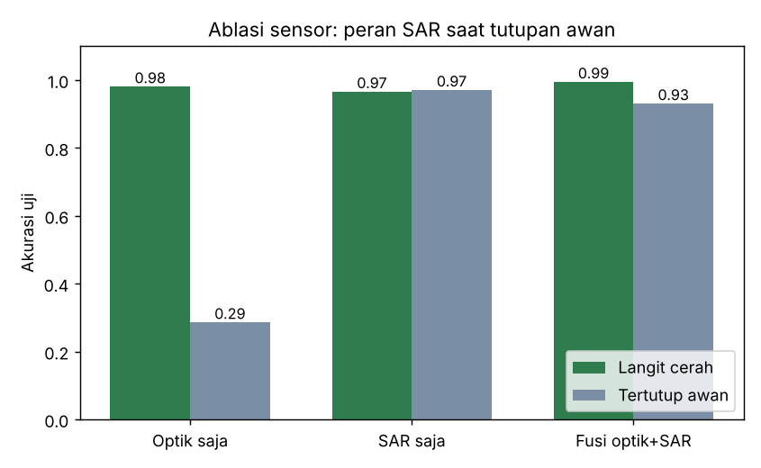
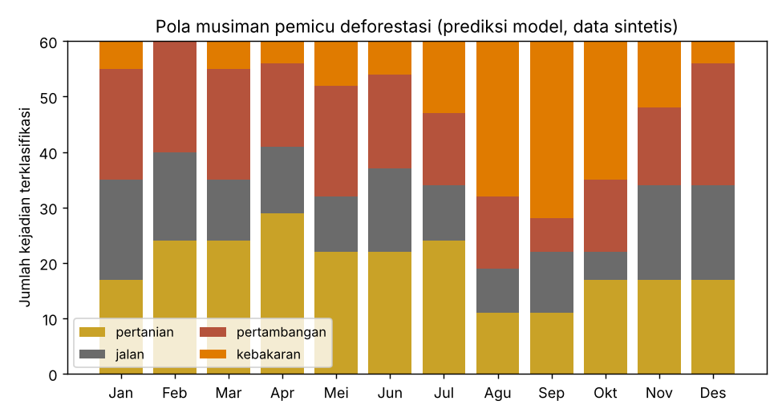
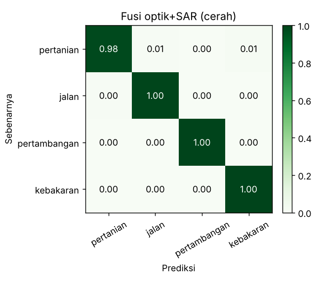
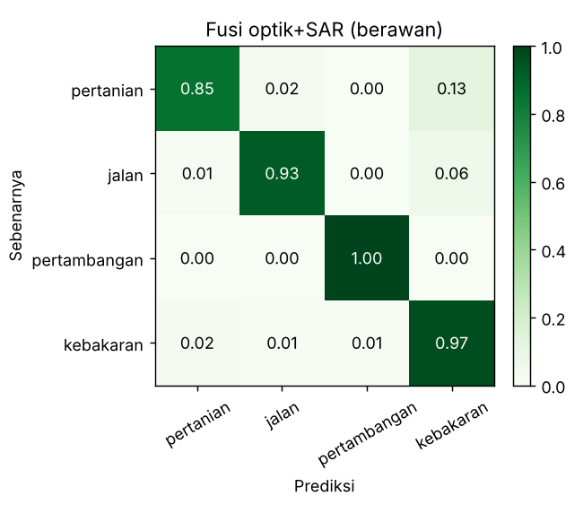
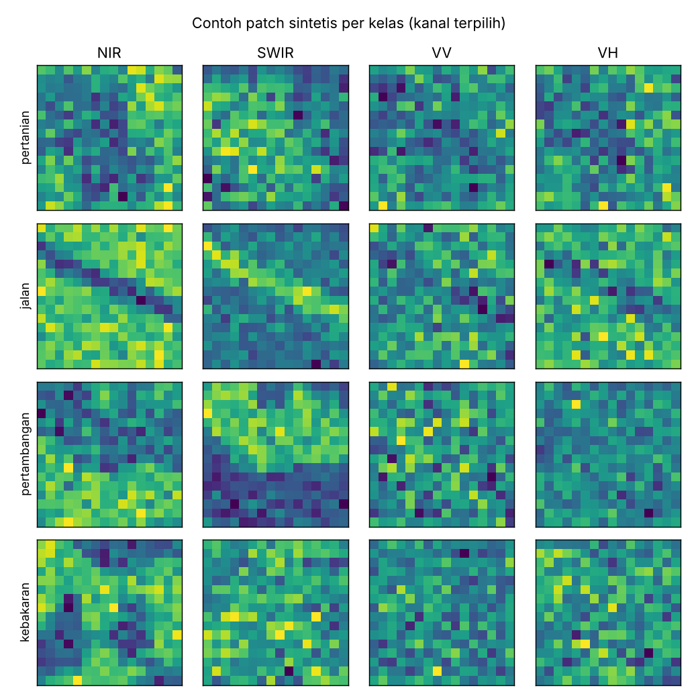

<div align="center">

# 🌲 Klasifikasi Pemicu Deforestasi dengan CNN Fusi Optik + SAR

**Studi kasus Sesi 6: pemantauan hutan tropis dari satelit dengan Deep Learning**


*Tanpa PyTorch/TensorFlow • Tanpa unduhan data • Selesai dalam ±1 menit di CPU*

</div>

---

## 📑 Daftar Isi
1. [Latar Belakang](#-latar-belakang)
2. [Studi Kasus](#-studi-kasus)
3. [Batasan Masalah](#-batasan-masalah)
4. [Pendekatan & Arsitektur](#-pendekatan--arsitektur)
5. [Struktur Proyek](#-struktur-proyek)
6. [Cara Menjalankan](#-cara-menjalankan)
7. [Hasil](#-hasil)
8. [Analisis & Temuan](#-analisis--temuan)
9. [Keterbatasan Jujur](#-keterbatasan-jujur)
10. [Pengembangan Lanjutan](#-pengembangan-lanjutan)
11. [Upload ke GitHub](#-upload-ke-github)

---

## 🌍 Latar Belakang

Hutan tropis krusial bagi keseimbangan bumi, tetapi terus terancam alih fungsi lahan. Materi Sesi 6 menekankan tiga ide yang menjadi dasar proyek ini:

| Ide dari materi | Diwujudkan dalam proyek ini |
|---|---|
| Citra optik + radar **SAR Sentinel-1** yang menembus awan | 6 kanal input: 4 optik + 2 SAR (VV, VH) |
| **CNN** + data multi-sensor untuk mengklasifikasikan **pemicu** deforestasi (pertanian, jalan, pertambangan, kebakaran) | CNN 2 lapis konvolusi, 4 kelas keluaran |
| Analisis **pola spasial dan musiman**, tetap perlu **validasi lapangan** | Peta bentuk per kelas, grafik musiman, dan pembahasan keterbatasan |

## 🎯 Studi Kasus

> **Skenario:** Sebuah unit pemantau hutan sudah punya peringatan dini *"ada tutupan pohon yang hilang"* tiap pekan. Namun petugas lapangan kewalahan karena tidak tahu **penyebabnya**: apakah ladang baru, jalan logging, tambang, atau kebakaran? Tiap penyebab butuh respons berbeda.
>
> **Tugas:** bangun model yang menerima *patch* citra 16×16 piksel dari area yang baru kehilangan tutupan, lalu menentukan **pemicu**-nya secara otomatis, bahkan ketika langit **tertutup awan** (kondisi umum di wilayah tropis).

**Pertanyaan penelitian**
1. Seberapa akurat CNN mengklasifikasikan 4 pemicu deforestasi dari data multi-sensor?
2. Seberapa besar kontribusi SAR dibanding optik, terutama saat berawan? *(ablasi sensor)*
3. Apakah pola musiman (mis. kebakaran di musim kemarau) dapat terlihat dari hasil klasifikasi?

**Kelas pemicu & "tanda tangan" fisiknya**

| Kelas | Bentuk spasial | Ciri optik | Ciri SAR |
|---|---|---|---|
| 🌾 Pertanian | Petak persegi panjang sejajar sumbu | NIR sedang, tanah terbuka | Backscatter turun sedang (permukaan halus) |
| 🛣️ Jalan | Garis tipis, sudut bebas | Terang, NIR rendah | Backscatter paling rendah (pantulan spekular) |
| ⛏️ Pertambangan | Area besar tidak beraturan, tepi tegas | SWIR sangat tinggi | Backscatter **tinggi** (permukaan kasar) |
| 🔥 Kebakaran | Area tidak beraturan, tepi berbulu | NIR & red rendah (area hangus gelap), SWIR naik | Turun ringan |

## 🧱 Batasan Masalah

Agar proyek tetap sederhana, dapat direproduksi tanpa akun/unduhan, dan ringan dijalankan:

1. **Data sintetis.** Patch dibangkitkan secara prosedural (`src/synth_data.py`) dengan meniru perilaku fisik yang disederhanakan. **Bukan** citra Sentinel-1/2 asli.
2. **Satu kejadian per patch**, ukuran 16×16 piksel, dan satu pemicu dominan. Tidak ada patch campuran (mis. ladang yang juga terbakar).
3. **Empat kelas saja:** pertanian, jalan, pertambangan, kebakaran. Tidak ada kelas "tidak ada perubahan" karena deteksi hilangnya tutupan diasumsikan sudah dilakukan tahap sebelumnya.
4. **Awan disimulasikan** sebagai penutup penuh pada kanal optik (kanal SAR tetap bersih). Awan parsial, bayangan awan, dan kabut tidak dimodelkan.
5. **Analisis musiman** memakai prior kelas buatan per bulan (kebakaran memuncak Agu–Okt). Ini ilustrasi mekanisme analisis, **bukan temuan empiris** tentang hutan nyata.
6. **Model dari nol dengan NumPy**: sengaja kecil agar transparan dan bisa dijalankan di mana saja. Bukan model yang dioptimalkan untuk produksi.
7. **Tidak ada validasi lapangan** (*ground truthing*), padahal dalam praktik langkah ini wajib.

## 🧠 Pendekatan & Arsitektur

```
Patch 16×16×6  ──►  Conv3×3(8)+ReLU ─► MaxPool2 ─► Conv3×3(8)+ReLU ─► MaxPool2
 (red, nir, swir,                                                        │
  Δndvi, VV, VH)                                           Flatten (8·4·4=128)
                                                                          │
                                           Dense(32)+ReLU ─► Dense(4) ─► Softmax
                                                                          │
                                         {pertanian, jalan, pertambangan, kebakaran}
```

- **Implementasi:** `Conv`, `MaxPool`, `ReLU`, `Dense` dan optimizer **Adam** ditulis manual dengan backpropagation sendiri. Gradien sudah diverifikasi dengan *finite difference* (galat relatif ~1e-7).
- **Fusi sensor:** *early fusion*, yaitu kanal optik dan SAR ditumpuk jadi satu tensor input.
- **Ketahanan awan:** 30% patch latih sengaja berawan, sehingga model belajar memakai SAR saat optik tidak informatif.
- **Evaluasi:** akurasi, F1-macro, dan confusion matrix pada dua set uji: **cerah** dan **100% berawan**.

## 📁 Struktur Proyek

```
deforestation-driver-cnn/
├── README.md              ← dokumen ini
├── requirements.txt       ← numpy, scipy, matplotlib
├── LICENSE                ← MIT
├── .gitignore
├── src/
│   ├── synth_data.py      ← generator patch sintetis 6 kanal + prior musiman
│   ├── cnn_numpy.py       ← CNN murni NumPy (forward, backprop, Adam)
│   └── train.py           ← pipeline: data → latih → ablasi → analisis musiman
└── results/               ← keluaran (grafik PNG + metrics.json)
```

## ▶️ Cara Menjalankan

```bash
# 1. (opsional) buat virtual environment
python -m venv .venv
source .venv/bin/activate        # Windows: .venv\Scripts\activate

# 2. pasang dependensi
pip install -r requirements.txt

# 3. jalankan pipeline lengkap (±1 menit di CPU)
python -m src.train

# atau mode cepat untuk uji coba (±10 detik)
python -m src.train --quick
```

Semua keluaran tersimpan di folder `results/`. Hasil bersifat deterministik untuk `--seed` yang sama.

## 📊 Hasil

Hasil run penuh (2.400 patch latih, 800 patch uji per kondisi, 14 epoch, seed 42):

| Skenario input | Akurasi (cerah) | F1-macro (cerah) | Akurasi (berawan) | F1-macro (berawan) |
|---|:---:|:---:|:---:|:---:|
| Optik saja (4 kanal) | 0,981 | 0,981 | **0,286** | 0,274 |
| SAR saja (2 kanal) | 0,966 | 0,966 | **0,971** | 0,973 |
| **Fusi optik + SAR (6 kanal)** | **0,995** | **0,995** | 0,931 | 0,935 |

<table>
<tr>
<td align="center"><br><sub>Ablasi sensor</sub></td>
<td align="center"><br><sub>Pola musiman hasil klasifikasi</sub></td>
</tr>
<tr>
<td align="center"><br><sub>Confusion matrix, fusi (cerah)</sub></td>
<td align="center"><br><sub>Confusion matrix, fusi (berawan)</sub></td>
</tr>
<tr>
<td colspan="2" align="center"><br><sub>Contoh patch sintetis per kelas</sub></td>
</tr>
</table>

## 🔍 Analisis & Temuan

1. **Optik sangat kuat saat cerah, tetapi runtuh saat berawan.** Akurasi turun dari 0,98 ke 0,29, nyaris tebakan acak (0,25). Ini alasan utama radar dibutuhkan di wilayah tropis.
2. **SAR stabil terhadap awan.** Akurasinya hampir sama di kedua kondisi (0,97), sesuai sifat radar yang menembus awan seperti dijelaskan di materi.
3. **Fusi terbaik saat cerah (0,995)**, karena menggabungkan informasi bentuk dan spektral.
4. **Temuan tak terduga:** saat berawan, **fusi (0,931) sedikit kalah dari SAR saja (0,971)**. Model fusi sempat "terkecoh" oleh kanal optik yang berisi awan, karena hanya 30% data latih yang berawan. Ini menunjukkan *early fusion* tidak otomatis ideal. Perlu augmentasi awan lebih agresif, *dropout* per-sensor, atau arsitektur dua cabang (*late fusion*) dengan gerbang kepercayaan.
5. **Pola musiman terlihat:** proporsi kebakaran melonjak pada Agu–Okt (musim kemarau), sedangkan pertanian/jalan/tambang relatif stabil. Perlu diingat, ini mengikuti prior yang dibuat sendiri; yang diuji di sini adalah kemampuan model menangkapnya, bukan fenomena nyata.

## ⚠️ Keterbatasan Jujur

- Angka akurasi tinggi **tidak boleh** dibaca sebagai performa di dunia nyata. Data sintetis jauh lebih bersih dan kelasnya lebih mudah dipisahkan dibanding citra asli.
- Hanya satu run per skenario (satu seed), jadi selisih kecil seperti 0,966 vs 0,971 tidak signifikan secara statistik.
- Sesuai materi, hasil klasifikasi pada data nyata **harus divalidasi lapangan** sebelum dipakai untuk penegakan hukum atau kebijakan.

## 🚀 Pengembangan Lanjutan

- [ ] Ganti data sintetis dengan citra nyata (Sentinel-1 GRD + Sentinel-2 L2A lewat Google Earth Engine atau Copernicus) dengan label dari data peringatan dini
- [ ] Porting model ke PyTorch dan tambah arsitektur *late fusion* atau *attention* antar-sensor
- [ ] Tambah kelas "tidak ada perubahan" dan patch campuran
- [ ] Augmentasi awan parsial dan bayangan awan
- [ ] Ulangi dengan banyak seed lalu laporkan rata-rata ± simpangan baku

## 🐙 Upload ke GitHub

**1. Buat repositori kosong** di <https://github.com/new> (mis. `deforestation-driver-cnn`, tanpa README/LICENSE karena sudah ada).

**2. Dari folder proyek di komputer Anda:**

```bash
unzip deforestation-driver-cnn.zip
cd deforestation-driver-cnn

git init
git add .
git commit -m "Studi kasus: klasifikasi pemicu deforestasi dengan CNN fusi optik+SAR"
git branch -M main
git remote add origin https://github.com/<USERNAME>/deforestation-driver-cnn.git
git push -u origin main
```

Ganti `<USERNAME>` dengan username GitHub Anda. Jika diminta kata sandi, gunakan *Personal Access Token* (Settings → Developer settings → Tokens) atau login lewat `gh auth login`.

**3. Alternatif tanpa terminal:** buka repositori baru → *Add file* → *Upload files* → seret seluruh isi folder.

---

<div align="center"><sub>Dibuat sebagai latihan pembelajaran dari materi Sesi 6 • Data sintetis, bukan untuk pengambilan keputusan nyata</sub></div>
