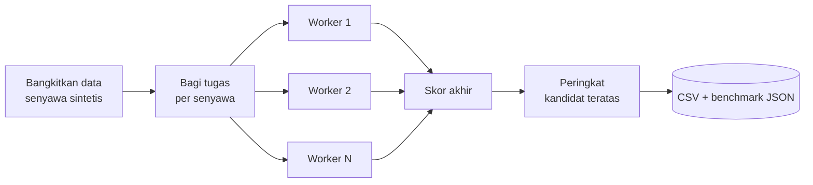

<div align="center">

# 🌿 Herbal Screening HPC

### Penapisan Senyawa Herbal Indonesia Secara Paralel

*Studi kasus komputasi berperforma tinggi (HPC) skala mini: dari **coder** menjadi **integrator sistem***


-orange)

</div>

---

## 📑 Daftar Isi
1. [Latar Belakang](#-latar-belakang)
2. [Rumusan Masalah & Tujuan](#-rumusan-masalah--tujuan)
3. [Batasan Masalah](#-batasan-masalah)
4. [Metode & Arsitektur](#-metode--arsitektur)
5. [Struktur Proyek](#-struktur-proyek)
6. [Cara Menjalankan](#-cara-menjalankan)
7. [Contoh Output](#-contoh-output)
8. [Membaca Hasil Benchmark](#-membaca-hasil-benchmark)
9. [Keterkaitan dengan Materi Sesi 2](#-keterkaitan-dengan-materi-sesi-2)
10. [Pengembangan Lanjutan](#-pengembangan-lanjutan)
11. [Upload ke GitHub](#-upload-ke-github)
12. [Lisensi](#-lisensi)

---

## 🔎 Latar Belakang

Indonesia memiliki keanekaragaman hayati yang luar biasa, termasuk ribuan tanaman
obat tradisional (jamu) seperti kunyit, jahe, temulawak, dan sambiloto. Menguji
setiap senyawa aktifnya di laboratorium sangat mahal dan lambat.

Pada materi **Sesi 2**, salah satu studi kasus HPC adalah **percepatan penapisan
obat herbal** (*virtual screening*): komputer menyaring ribuan kandidat senyawa
lebih dulu, sehingga laboratorium hanya menguji kandidat yang paling menjanjikan.

Proyek ini mensimulasikan alur tersebut dalam skala kecil dan **bisa dijalankan di
laptop biasa**, untuk menunjukkan satu ide inti HPC: **membagi pekerjaan besar ke
banyak inti CPU agar selesai lebih cepat.**

## 🎯 Rumusan Masalah & Tujuan

**Rumusan masalah**
1. Bagaimana menyaring ribuan senyawa herbal secara sistematis berdasarkan sifat
   *drug-likeness* dan perkiraan afinitas ikatan?
2. Seberapa besar percepatan yang diperoleh jika penapisan dijalankan paralel
   dibanding serial?

**Tujuan**
- Membangun *pipeline* penapisan: data → aturan filter → simulasi docking → peringkat.
- Membandingkan waktu eksekusi serial vs paralel (speedup & efisiensi).
- Melatih peran **integrator sistem**: merancang alur, bukan sekadar menulis fungsi.

## 🚧 Batasan Masalah

| # | Batasan | Penjelasan |
|---|---------|------------|
| 1 | **Data sintetis** | Sifat molekul dibangkitkan acak (seed tetap), *bukan* data kimia nyata. |
| 2 | **Docking disimulasikan** | `energi_docking()` adalah fungsi pengganti yang berat secara CPU, *bukan* docking molekuler sungguhan (mis. AutoDock). |
| 3 | **Bukan klaim medis** | Peringkat kandidat tidak punya nilai ilmiah/klinis. Hanya untuk edukasi. |
| 4 | **Satu mesin** | Paralelisme memakai `multiprocessing` pada satu komputer, bukan klaster/superkomputer. |
| 5 | **Aturan sederhana** | Hanya Lipinski (Rule of Five) dan Veber; tanpa toksisitas, ADMET, atau sifat lain. |
| 6 | **Tanpa dependensi luar** | Hanya pustaka standar Python agar mudah dijalankan siapa saja. |

## 🧠 Metode & Arsitektur



**Skor akhir** setiap senyawa:

```
skor = -energi_docking - 1.5 × pelanggaran_Lipinski - 1.0 × pelanggaran_Veber
```

- **Lipinski**: MW ≤ 500, logP ≤ 5, H-donor ≤ 5, H-acceptor ≤ 10.
- **Veber**: rotatable bonds ≤ 10, TPSA ≤ 140.
- **Energi docking (simulasi)**: energi terbaik dari ribuan "pose" acak yang
  deterministik per senyawa, sehingga hasil serial dan paralel **identik**
  (diverifikasi oleh unit test).

**Mengapa paralel cocok?** Setiap senyawa dinilai **independen** (*embarrassingly
parallel*), sehingga pekerjaan bisa dibagi rata tanpa komunikasi antar-worker.

## 🗂 Struktur Proyek

```
herbal-screening-hpc/
├── herbal_screening/
│   ├── __init__.py
│   ├── data.py        # pembangkit data senyawa sintetis
│   ├── scoring.py     # aturan Lipinski/Veber + simulasi docking
│   └── pipeline.py    # versi serial & paralel (multiprocessing)
├── tests/
│   └── test_scoring.py
├── results/           # keluaran CSV & benchmark
├── main.py            # CLI utama
├── README.md
├── LICENSE
└── .gitignore
```

## 🚀 Cara Menjalankan

Prasyarat: **Python 3.8+** (tanpa `pip install`).

```bash
# 1. Jalankan unit test
python -m unittest

# 2. Penapisan paralel (default: semua core CPU)
python main.py --n 1000 --poses 5000

# 3. Bandingkan serial vs paralel
python main.py --n 1000 --poses 5000 --benchmark

# 4. Atur sendiri
python main.py --n 2000 --poses 8000 --workers 4 --top 15 --seed 7 --benchmark
```

| Argumen | Default | Keterangan |
|---------|---------|-----------|
| `--n` | 1000 | Jumlah senyawa |
| `--poses` | 5000 | Pose per senyawa (makin besar, makin berat) |
| `--workers` | semua core | Jumlah proses paralel |
| `--top` | 10 | Jumlah kandidat teratas |
| `--seed` | 42 | Seed data agar reproduktif |
| `--benchmark` | off | Jalankan juga versi serial lalu hitung speedup |

## 📊 Contoh Output

Contoh nyata (800 senyawa, 4000 pose, seed 42):

```
Top 8 kandidat:
#  Nama       Sumber          Energi  Lip  Ver    Skor
1  HRB-00631  Jahe           -12.412    0    0  12.412
2  HRB-00319  Sirih          -12.108    0    0  12.108
3  HRB-00000  Jahe           -12.089    0    0  12.089
4  HRB-00735  Meniran        -12.065    0    0  12.065
5  HRB-00067  Temulawak      -12.049    0    0  12.049
6  HRB-00121  Pegagan        -11.898    0    0  11.898
7  HRB-00280  Pegagan        -11.777    0    0  11.777
8  HRB-00553  Meniran        -11.668    0    0  11.668
```

Berkas keluaran: `results/kandidat_teratas.csv` dan (jika `--benchmark`)
`results/benchmark.json`.

## ⏱ Membaca Hasil Benchmark

- **Speedup** = waktu serial ÷ waktu paralel.
- **Efisiensi** = speedup ÷ jumlah worker × 100%.

> ⚠️ **Catatan jujur:** contoh di atas dijalankan pada lingkungan **1 core CPU**,
> sehingga speedup ≈ 1× (tidak ada yang bisa diparalelkan). Di laptop 4–8 core,
> Anda akan melihat speedup yang jauh lebih besar. Jalankan `--benchmark` di
> mesin Anda sendiri dan catat hasilnya di tabel berikut:

| Mesin | Core | Worker | Serial (s) | Paralel (s) | Speedup |
|-------|------|--------|-----------|-------------|---------|
| _(isi sendiri)_ | | | | | |

## 🎓 Keterkaitan dengan Materi Sesi 2

| Poin materi | Wujud di proyek ini |
|-------------|--------------------|
| HPC sebagai kebutuhan fundamental | Pembagian beban kerja ke banyak core (`multiprocessing.Pool`) |
| Percepatan penapisan obat herbal | Pipeline *virtual screening* senyawa jamu |
| Coder → integrator sistem | Menggabungkan data, aturan sains, paralelisme, benchmark, dan test dalam satu alur |
| Menjawab tantangan lokal | Fokus pada tanaman obat Indonesia |

## 🌱 Pengembangan Lanjutan

- Ganti data sintetis dengan basis data nyata (mis. koleksi senyawa tanaman obat Indonesia).
- Ganti simulasi docking dengan alat sungguhan (AutoDock Vina, RDKit).
- Tambah prediksi toksisitas/ADMET.
- Skalakan ke klaster dengan `mpi4py` atau Dask.
- Visualisasi hasil dengan `matplotlib`.

## 🐙 Upload ke GitHub

```bash
cd herbal-screening-hpc
git init
git add .
git commit -m "feat: studi kasus penapisan senyawa herbal paralel"
git branch -M main
git remote add origin https://github.com/<username-anda>/herbal-screening-hpc.git
git push -u origin main
```

Buat dulu repositori kosong bernama `herbal-screening-hpc` di github.com
(tanpa README/LICENSE otomatis agar tidak konflik).

## 📄 Lisensi

[MIT](LICENSE). Bebas dipakai dan dimodifikasi untuk belajar.
