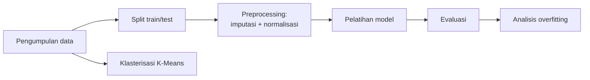
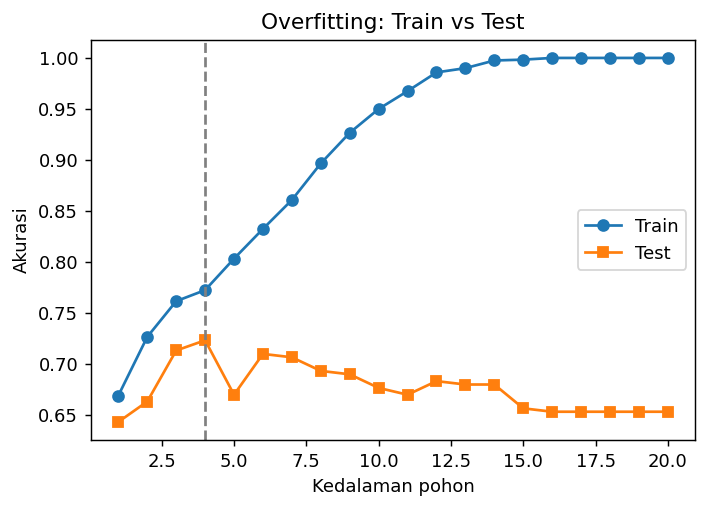
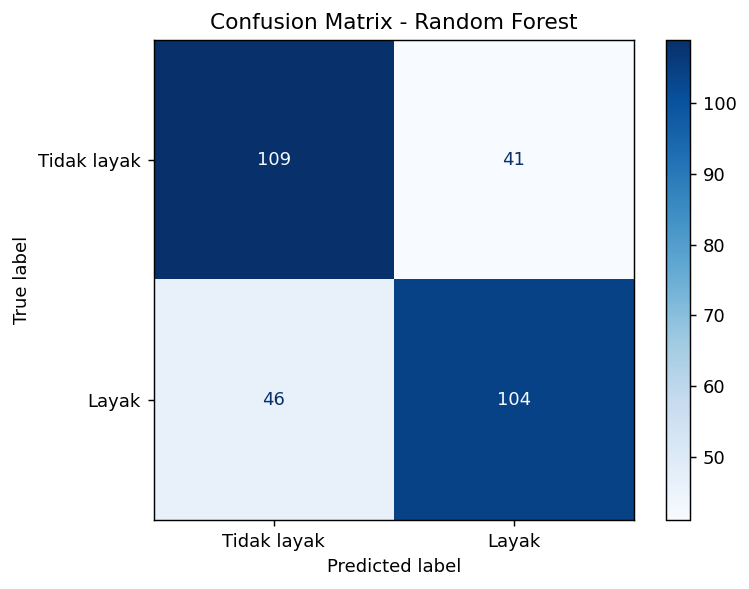
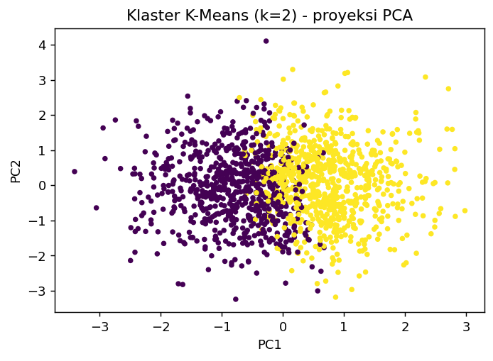

<div align="center">

# 💧 Klasifikasi Kelayakan Air Minum dengan Machine Learning

**Studi kasus pengantar Machine Learning: dari data mentah hingga evaluasi model**


</div>

---

## 📌 Latar Belakang

Pengujian kualitas air secara manual membutuhkan waktu dan biaya. Dengan *Machine Learning*, sistem dapat **belajar dari data parameter air** (pH, kekeruhan, padatan terlarut, dll.) untuk memperkirakan apakah suatu sampel **layak minum atau tidak**.

Proyek ini dibuat sebagai penerapan materi pengantar *Machine Learning*: alur kerja data, tiga pendekatan pembelajaran, serta tantangan seperti kualitas data dan *overfitting*.

## 🎯 Rumusan Masalah

1. Bagaimana memprediksi kelayakan air minum dari 8 parameter kualitas air?
2. Algoritma mana yang paling baik untuk kasus ini?
3. Bagaimana *overfitting* muncul dan cara mengendalikannya?
4. Apakah data memiliki pola kelompok alami tanpa melihat label?

## 🚧 Batasan Masalah

| No | Batasan |
|----|---------|
| 1 | Data bersifat **sintetis** (dibangkitkan oleh `src/generate_data.py`), **bukan** data lapangan. Hasil tidak boleh dipakai untuk keputusan kesehatan nyata. |
| 2 | Masalah dibatasi pada **klasifikasi biner** (layak / tidak layak). |
| 3 | Hanya **8 fitur numerik**: pH, kekerasan, padatan terlarut, kloramin, sulfat, konduktivitas, karbon organik, kekeruhan. |
| 4 | Algoritma terbatas pada 3 model: *Logistic Regression*, *Decision Tree*, *Random Forest*. |
| 5 | *Hyperparameter tuning* hanya berupa eksperimen kedalaman pohon (tanpa *grid search*). |
| 6 | *Reinforcement learning* hanya dibahas konsep, **tidak diimplementasikan** karena tidak sesuai dengan kasus ini. |

## 🔄 Alur Kerja



| Tahap materi | Implementasi di proyek |
|---|---|
| Pengumpulan data mentah | Dataset sintetis 1.500 sampel, 8 fitur |
| *Data preprocessing* | `SimpleImputer` (median) untuk nilai hilang, `StandardScaler` untuk normalisasi |
| Pembagian data | 80% *training* / 20% *testing* (stratified) |
| *Supervised learning* | Klasifikasi dengan 3 algoritma |
| *Unsupervised learning* | Klasterisasi K-Means + visualisasi PCA |
| Evaluasi model | Akurasi, F1-score, *confusion matrix* |
| Tantangan: *overfitting* | Kurva kedalaman pohon vs akurasi |
| Tantangan: kualitas data | Nilai hilang ±6% dan *noise* sengaja ditambahkan |

> 💡 Preprocessing dibungkus dalam `Pipeline` dan hanya "belajar" dari data *training*, sehingga tidak terjadi **data leakage**.

## 📁 Struktur Proyek

```
ml-kelayakan-air/
├── main.py              # Program utama (jalankan ini)
├── src/
│   └── generate_data.py # Pembuat dataset sintetis
├── data/                # kualitas_air.csv (dibuat otomatis)
├── outputs/             # grafik & hasil.txt (dibuat otomatis)
├── requirements.txt
├── .gitignore
└── README.md
```

## 🚀 Cara Menjalankan

```bash
# 1. Clone repositori
git clone https://github.com/<username>/ml-kelayakan-air.git
cd ml-kelayakan-air

# 2. (Opsional) buat virtual environment
python -m venv .venv
source .venv/bin/activate        # Windows: .venv\Scripts\activate

# 3. Pasang dependensi
pip install -r requirements.txt

# 4. Jalankan
python main.py
```

Seluruh hasil tersimpan otomatis di folder `outputs/`.

## 📊 Hasil

| Model | Akurasi (test) | F1-score | Akurasi (train) |
|---|:---:|:---:|:---:|
| Logistic Regression | 0,640 | 0,630 | 0,707 |
| Decision Tree (tanpa batas) | 0,653 | 0,641 | 1,000 |
| **Random Forest** ⭐ | **0,710** | **0,705** | 1,000 |

**Overfitting:** *Decision Tree* tanpa batas menghafal data latih (akurasi 100%) tetapi turun ke 65,3% pada data uji. Dengan membatasi kedalaman menjadi **4**, akurasi uji naik menjadi **72,3%**.

<p align="center">
  
  
</p>

**Klasterisasi:** K-Means menghasilkan *silhouette score* sekitar 0,09 (rendah), artinya data **tidak memiliki kelompok alami yang jelas**.

<p align="center"></p>

## 🧠 Kesimpulan

1. *Random Forest* paling baik (akurasi ±71%) karena menggabungkan banyak pohon sehingga lebih tahan terhadap *noise*.
2. Akurasi tinggi pada data latih belum tentu bagus. **Selalu ukur pada data uji.**
3. Membatasi kompleksitas model (`max_depth`) efektif mengurangi *overfitting*.
4. Klasterisasi tidak menemukan kelompok kuat, menunjukkan *unsupervised learning* bergantung pada struktur data.
5. Akurasi masih moderat karena data sengaja dibuat berisik, mencerminkan tantangan **kualitas data** di dunia nyata.

## 🔭 Pengembangan Lanjutan

- Memakai dataset nyata (mis. *Water Potability* dari Kaggle)
- *Grid search* / *cross-validation*
- Menambah metrik ROC-AUC dan *feature importance*
- Membuat antarmuka web sederhana (Streamlit)

## ⚖️ Etika

Model ini hanya untuk **pembelajaran**. Prediksi kelayakan air minum pada kondisi nyata harus berdasarkan uji laboratorium resmi. Kesalahan *false positive* (air berbahaya diprediksi layak) berisiko serius bagi kesehatan.

## 📄 Lisensi

MIT License. Bebas digunakan untuk belajar dan dikembangkan.
