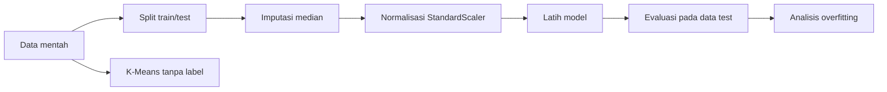
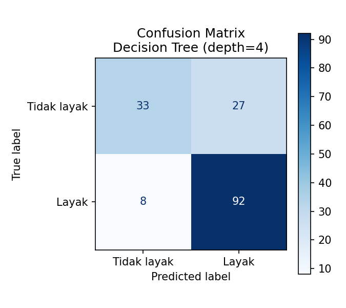
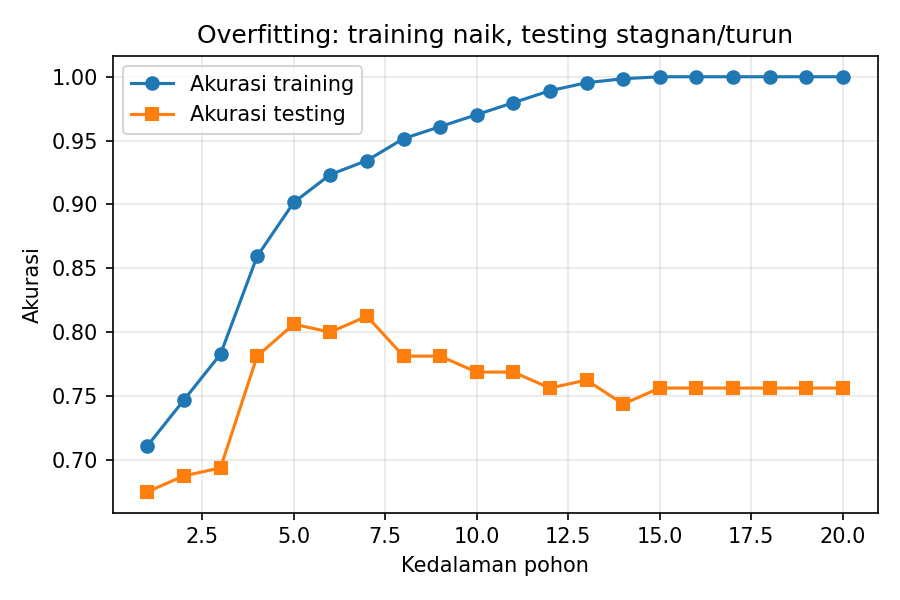
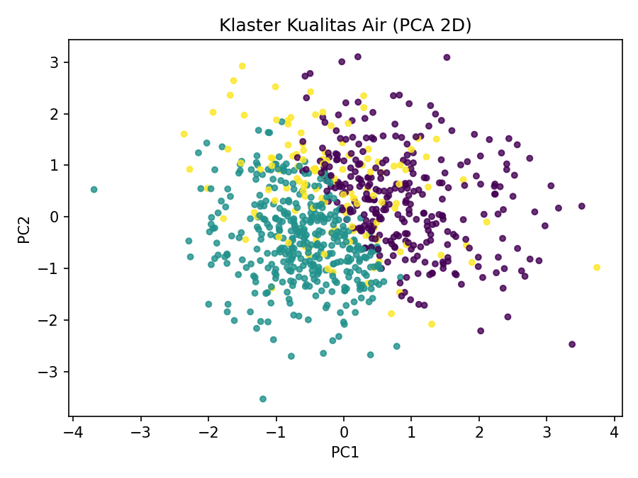

<div align="center">

# 💧 Klasifikasi Kelayakan Kualitas Air Sungai
### Studi Kasus Pengantar Machine Learning


*Dari data sensor mentah yang berantakan hingga model yang bisa memutuskan: air ini layak atau tidak?*

</div>

---

## 📑 Daftar Isi
1. [Latar Belakang](#-latar-belakang)
2. [Rumusan Masalah & Tujuan](#-rumusan-masalah--tujuan)
3. [Batasan Masalah](#-batasan-masalah)
4. [Dataset](#-dataset)
5. [Alur Kerja](#-alur-kerja-machine-learning)
6. [Struktur Proyek](#-struktur-proyek)
7. [Cara Menjalankan](#-cara-menjalankan)
8. [Hasil & Analisis](#-hasil--analisis)
9. [Pertimbangan Etika](#-pertimbangan-etika)
10. [Pengembangan Lanjutan](#-pengembangan-lanjutan)

---

## 🌍 Latar Belakang
Banyak masyarakat masih menggunakan air sungai untuk keperluan sehari-hari. Pengujian laboratorium akurat tetapi mahal dan lambat. Dengan *Machine Learning*, hasil pembacaan sensor sederhana (pH, kekeruhan, oksigen terlarut, dll.) dapat dipelajari polanya untuk **memberi skrining awal** apakah suatu sampel air layak dipakai.

Proyek ini dibuat sebagai **studi kasus pembelajaran** yang menerapkan seluruh konsep dari materi pengantar Machine Learning.

## 🎯 Rumusan Masalah & Tujuan
**Rumusan masalah:** Bagaimana membangun model yang dapat memprediksi kelayakan air sungai dari data sensor yang mengandung nilai hilang?

**Tujuan:**
- Menerapkan alur ML lengkap: pengumpulan → prapemrosesan → pembagian data → pemilihan algoritma → evaluasi.
- Membandingkan dua algoritma *supervised learning* (klasifikasi).
- Mendemonstrasikan **overfitting** secara visual.
- Menerapkan **unsupervised learning** (klasterisasi) untuk menemukan pola tanpa label.

## 🚧 Batasan Masalah
| No | Batasan |
|----|---------|
| 1 | Data bersifat **sintetis** (dibangkitkan program), bukan hasil pengukuran lapangan. |
| 2 | Label "layak/tidak layak" dibuat dari aturan sederhana + *noise* 7%, **bukan standar baku mutu resmi**. |
| 3 | Hanya **6 fitur** numerik dan **800 sampel**. |
| 4 | Hanya klasifikasi biner (layak / tidak layak). |
| 5 | Algoritma terbatas: Logistic Regression, Decision Tree, K-Means. |
| 6 | *Reinforcement learning* hanya dibahas konsepnya, tidak diimplementasikan. |
| 7 | Hasil **tidak boleh dipakai** sebagai dasar keputusan kesehatan nyata. |

## 📊 Dataset
Dibangkitkan oleh `src/generate_data.py` (seed tetap, hasil selalu sama).

| Fitur | Satuan | Keterangan |
|-------|--------|-----------|
| `ph` | – | Tingkat keasaman |
| `kekeruhan_ntu` | NTU | Kejernihan air |
| `oksigen_terlarut_mgl` | mg/L | Kadar oksigen (DO) |
| `suhu_c` | °C | Suhu air |
| `bod_mgl` | mg/L | Kebutuhan oksigen biologis |
| `konduktivitas_us` | µS/cm | Kandungan ion terlarut |
| **`layak`** | 0 / 1 | **Target** (label) |

Sekitar **8% nilai tiap fitur sengaja dihilangkan** agar proses pembersihan data benar-benar bermakna.

## 🔄 Alur Kerja Machine Learning



| Tahap materi | Implementasi di proyek |
|---|---|
| Pengumpulan data mentah | `buat_data()` menghasilkan CSV |
| Prapemrosesan | `SimpleImputer` (nilai hilang) + `StandardScaler` (normalisasi) |
| Split training/testing | `train_test_split` 80:20 dengan `stratify` |
| Pemilihan algoritma | Logistic Regression vs Decision Tree |
| Evaluasi | Akurasi, precision, recall, F1, confusion matrix |
| Supervised learning | Klasifikasi kelayakan air |
| Unsupervised learning | K-Means (k=3) + visualisasi PCA |
| Overfitting | Kurva akurasi vs kedalaman pohon |

> 💡 **Catatan penting:** pembagian data dilakukan *sebelum* imputasi dan normalisasi, dan semuanya dibungkus `Pipeline`. Ini mencegah **data leakage** (informasi data test bocor ke proses training).

## 📁 Struktur Proyek
```
ml-kualitas-air/
├── data/
│   └── kualitas_air.csv        # dataset hasil generate
├── src/
│   ├── generate_data.py        # pembangkit data sintetis
│   └── main.py                 # alur ML lengkap
├── outputs/
│   ├── confusion_matrix.png
│   ├── overfitting.png
│   ├── klaster.png
│   └── hasil_konsol.txt
├── requirements.txt
├── .gitignore
├── LICENSE
└── README.md
```

## 🚀 Cara Menjalankan
```bash
# 1. Clone repositori
git clone https://github.com/<username>/ml-kualitas-air.git
cd ml-kualitas-air

# 2. (Opsional) buat virtual environment
python -m venv .venv
source .venv/bin/activate        # Windows: .venv\Scripts\activate

# 3. Pasang dependensi
pip install -r requirements.txt

# 4. Jalankan
python src/main.py
```
Grafik akan tersimpan otomatis di folder `outputs/`.

## 📈 Hasil & Analisis

### 1. Perbandingan Model
| Model | Akurasi Test |
|-------|:-----------:|
| Logistic Regression | 0,738 |
| **Decision Tree (depth=4)** | **0,781** |

Decision Tree lebih unggul karena label dibentuk dari **aturan ambang batas** (mis. pH di rentang tertentu), yang secara alami cocok dengan struktur pohon keputusan, sedangkan Logistic Regression hanya membuat batas linear.

Detail model terbaik: recall kelas *Layak* = **0,92**, tetapi recall *Tidak layak* hanya **0,55**. Artinya model cenderung terlalu "optimis" menilai air layak.

<p align="center"></p>

### 2. Overfitting
Pada kedalaman pohon 20, akurasi training mencapai **1,000** namun testing hanya **0,756** (selisih 0,244). Model menghafal data latih, termasuk *noise*-nya, sehingga gagal menggeneralisasi.

<p align="center"></p>

### 3. Klasterisasi (Unsupervised)
K-Means menemukan 3 kelompok tanpa melihat label. Kelompok 2 ditandai kekeruhan tinggi (rata-rata ±17 NTU) dan hanya 42% sampelnya yang layak, sedangkan kelompok 1 ber-BOD rendah dengan 77% layak. Pola ini muncul murni dari data.

<p align="center"></p>

### Kesimpulan
1. Prapemrosesan (imputasi & normalisasi) membuat data berantakan dapat dipakai model.
2. Model sederhana yang tepat bisa mengalahkan model yang tidak cocok dengan struktur data.
3. Akurasi training tinggi **bukan** bukti model bagus; yang penting adalah performa di data baru.
4. Klasterisasi membantu memahami data tanpa label.

## ⚖️ Pertimbangan Etika
- **Risiko kesalahan:** model salah menyebut air "layak" (*false positive*) bisa membahayakan kesehatan. Dalam kasus nyata, metrik yang diutamakan sebaiknya recall untuk kelas "tidak layak".
- **Bias data:** model yang dilatih dari satu sungai belum tentu berlaku untuk sungai lain.
- **Transparansi:** keputusan harus bisa dijelaskan; Decision Tree dipilih salah satunya karena mudah diinterpretasi.
- **Peran manusia:** model hanya alat skrining, bukan pengganti uji laboratorium.

## 🔭 Pengembangan Lanjutan
- [ ] Gunakan data nyata dari stasiun pemantauan kualitas air
- [ ] Atur *class weight* untuk meningkatkan recall kelas "tidak layak"
- [ ] Coba Random Forest dan *cross-validation*
- [ ] Bangun dashboard sederhana dengan Streamlit

---
<div align="center">Dibuat untuk pembelajaran Machine Learning • Lisensi MIT</div>
